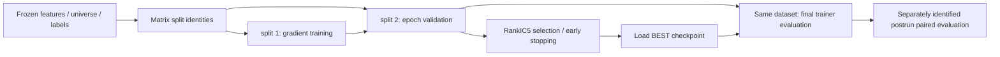

# V7 Data Reliability & Evaluation Fairness Preparation — Window03

Authority：[本輪Human decision](../knowledge/02_History/Decisions/20261021-data-evaluation-window03.json)。
唯一Backlog：[Research Program](../research/v7/research-program.md#data-evaluation-window-03)。
本報告為工程／研究準備證據，不是新Roadmap、研究批准或正式Evaluation Policy。
完整source identities、測試與review見[window03 evidence](../research/v7/data-evaluation-window03-evidence.json)。

## 1. Window02整合準備

從main `9956446d49371dbc5c09e1ea0bd9eaa750064532` 建立隔離候選，合併
Window02 `f34f9f32a86a0ee97a8dcdb74faad996bf5f5b4e`，僅在候選內調和五個
治理／導航衝突。四個工作單元完整保留，7個V6 blobs與Window02完全一致，
5個output hashes、11個pinned研究來源通過核對。

固定Stage1候選 **9bb4247**，兩父歷史均保留。259 tests PASS
（PIT49、非訓練E1 36、Portfolio67、Operations81、fetch/governance26）；
獨立review Critical0/Required0，**GO僅為本機工程整合建議**。
main未變；沒有main merge、push或deploy。後續parser變更另有commit，
不把新的source冒充這個Stage1固定候選。

## 2. Parser可靠性與MOPS政策邊界

`V6/marketmamba/data/fetcher.py`原路徑修復；不新增替代pipeline。

| 範圍 | 既有問題／contract | 本輪結果 |
|---|---|---|
| TWSE | request指定日期，但原先可把另一回應日標成請求日 | 日期先核對，缺失／不符走既有None路徑；合法日期及OHLCV值相容 |
| TPEx | 既有文件明列代號、收盤、開盤、最高、最低、成交股數，但實作硬編位置 | 使用唯一required欄名索引；重排／新增額外欄位保持數值，缺失或歧義欄名拒絕 |
| MOPS季度 | 兩市場缺一即整季拒絕；流量科目還需要完整前季 | mock驗證current/previous市場缺失均拒絕；source及閾值未改 |
| MOPS月營收 | 既有允許取得單一市場資料，沒有同樣的完整性政策 | 保留既有partial結果；仍保持千元→元、營收次月1日cache Date、空publication timestamp；不能升格PIT證據 |

RED8 tests/17 failures → GREEN8 PASS，獨立8 PASS，1修復輪。
測試載入完整fetcher source，但config、HTTP、HTML、quarterly acquisition均
隔離或mock，無網路、正式cache或production設定。recovery venv未安裝requests/
yfinance，測試以fixture modules替代，不安裝依賴。直接執行test檔避免package
`__init__`帶入operational config。這不是live provider／整條fetch pipeline認證。

```bash
CUDA_VISIBLE_DEVICES='' PYTHONDONTWRITEBYTECODE=1 \
/home/frank/projects/MarketMamba/.worktrees/v7-e1-colab-recovery/.venv/bin/python \
-B V6/marketmamba/data/test_official_parsers.py -q
```

月營收待Human決定：A全市場原子接受；B容許partial但以獲准的coverage契約
限制下游使用；C維持現狀並保持不可當完整PIT證據。**全為PROPOSED**，未實作
新旗標、財務口徑或資料修正。任何歷史資料補寫與營運部署另需批准。

## 3. E5／E1 split與checkpoint流程重建

此處新增精確流程及設計比較；Window02數值整理沿用，不重算研究結果。
來源以evidence中的12筆commit/path/SHA為準；核心程式固定於9bb4247，
歷史結果固定eec63c5；recovery evaluator固定de2b62e，不能互相代替。

| 角色 | Corrected E5 | E1 rolling-origin refresh |
|---|---|---|
| Training targets | 2013-01-02..2023-11-17 | 2013-01-02..2025-11-18 |
| Purge | 2023-11-20..2023-12-29，30 sessions | 2025-11-19..2025-12-31，30 sessions |
| Contract research evaluation | 2024-01-02..2026-09-11；labels另依horizon成熟度 | 2026-01-02起；5d至09-04，10d至08-28 |
| Validation角色 | 每epoch對split_code2算RankIC | 相同shared trainer／split_code2 |
| Model selection | best mean daily RankIC5；early stopping亦讀此結果 | 相同recipe，正式seed17/29皆best epoch1、last epoch6 |
| Final trainer evaluation | 載入best，再對同一evaluation dataset產生結果 | 相同；10d讀best-IC5 checkpoint，不是獨立選best-IC10 |
| Postrun evaluation | extended labels／equal-window／occlusion，support以各manifest為準 | recovery evaluator以314780 paired prediction keys對齊v2 labels |

E5原計畫含seed43，但正式完成結果只含17/29；不得用partial seed補足比較。
E1把E5的2024–2025研究evaluation時期納入新training window，是已批准的
refresh變數，不是隨機切分；也因此不能把E5全期間summary和E1 2026 summary
直接當同support比較。



可重現程式trace：`v7_e1_matrix.build_e1_arrays`透過assign_split編碼；
`v7_e1_run.run_seed`傳入E1config及validator；`v7_corrected_e5_train.train_seed`
建立split1/2兩個dataset（約386行），每epoch在evaluation上selection
（約474–522），最後再次交給evaluate_model（約525–536）。
**Validation、model selection、trainer final evaluation是不同用途，但不是三份
獨立資料。** 沒有額外untouched test split可以由命名推定。

## 4. Fairness／leakage風險與證據等級

| 風險 | 本輪證據 | 可下的結論／限制 |
|---|---|---|
| Selection與evaluation重用 | 同一evaluation object供selection及final | 有selection bias風險；不能稱untouched holdout。未量化bias，未重分類既有結果 |
| 多次研究使用同一歷史區間 | E5診斷、refresh比較、E1 postrun已使用2026 | 後續假說若據此調整，2026不能再被宣稱完全未觸碰；新實驗需Human事先凍結設計 |
| Horizon跨split／publication leakage | frozen purge30；PIT/labels各自有contracts | purge是必要邊界證據，不等於所有publication/revision/universe已認證 |
| 序列前視 | CorrectedMatrixDataset以history index<=target取trailing60，matrix排序契約Date/stock_id | source路徑不取future rows；原matrix缺失，未認證實際內容或完整PIT |
| Warmup／purge feature context | 較早feature rows可進入trailing窗口，但gradient targets僅split1 | 過去資訊作context本身不等於future label leakage；仍須確認實際publication時間與轉換因果性 |
| Feature transformation | metadata凍結causal per-session／expanding，no current-industry backfill/no graph | metadata檢查不是raw-byte／歷史publication證明；禁止用本輪PASS替代來源admission |
| 配對與缺label | E1 314780 prediction keys、307309匹配、7471 missing | 每horizon有效label support不同，不能用總keys當有效樣本數；paired comparison不自動消除selection bias |
| Checkpoint vs postrun mask | E5後續label extension／E1 postrun支持集另有identity | 原始payload/matrix未讀，不能假定每epoch與postrun有效mask完全相同 |
| 模型比較公平性 | features48、P0 labels、架構／recipe固定，E1只刷新split | 支持既有refresh問題範圍；不是Mamba優於所有baseline、graph必要性或feature deletion的證據 |

既有結果維持：E1 **PASS_REFRESH_HYPOTHESIS / HISTORICAL_SIMULATION_PROXY**；
E5 **STOP_FOR_TRADING_CONTINUE_RESEARCH**；E1 postrun epoch/regime
**INCONCLUSIVE**。本輪沒有更改上述分類。Strict Phase0 STOP、verified
executable labels=0、portfolio admission=false仍有效。

方法參考：Cawley與Talbot說明，有限樣本上的selection criterion也可能過擬合，
因此performance evaluation會有selection bias；這支持分離選模與評估的考量，
但不提供本專案bias數值。[JMLR作者摘要](https://www.jmlr.org/papers/v11/cawley10a.html)。

## 5. 下一次公平比較選項 — 全部PROPOSED

以下為依來源與專案結構提出的設計推論，非新增正式規則。沒有指定未批准的
新日期、Target、Label、fold數、閾值或訓練budget。

| 選項 | 設計輪廓 | 優點／主要限制 | 所需Human決策與資源 |
|---|---|---|---|
| Temporal holdout | train→獨立selection interval→凍結模型→一次性後續evaluation；邊界按已批准label maturity與PIT設計 | 分離角色清楚，compute相對較少；單一市場時段可能不代表其他regime，反覆看結果會消耗holdout | exact dates、selection規則、共同baseline/seeds、資料admission、最終metrics/support；新train/inference另批准 |
| Expanding／rolling walk-forward | 每fold只用當時可得過去資料，內層selection，後續fold evaluation；所有股票以session分組 | 多時段檢視staleness；多次重訓成本，重疊labels/folds不獨立；看fold後改設計仍有selection bias | fixed/expanding窗口、folds、purge、aggregation/uncertainty、比較budget；GPU另批准 |
| Nested temporal evaluation | 外層forward區間只估計整個選模程序；內層才比較feature/model/recipe | 適合真正有多候選搜尋的問題；compute最高、資料切細後support較少，不能保證未來regime | 是否需要模型搜尋、候選集合、內外層邊界、調參budget、多重比較／停止規則 |
| 保持現有模型的後續觀測 | 不重選checkpoint；未來合格資料到達後按預先凍結方法記錄 | 不必立即新訓練；仍需資料及inference批准，也不是即時交易證據 | 觀測區間、publication/admission、是否允許人工介入與report頻率；不得自動改scheduler |

TimeSeriesSplit官方文件提供時間順序fold與gap機制，並要求等間距樣本才能
讓fold時長可比較；本專案是日×股票panel，不能直接把排序後的每列當一個
session來套用gap。應先由Human凍結session-level設計再工程化。
[官方文件](https://scikit-learn.org/stable/modules/generated/sklearn.model_selection.TimeSeriesSplit.html)。

共同待凍結項：正式問題、baseline集合、selection與最終evaluation角色、
forecast/label口徑、PIT/universe/feature identity、有效support與missing policy、
seed處理、模型挑選budget、成本／不確定性報告、acceptance、GPU資源。
Agent沒有代選；現有E1 gate繼續只適用原frozen問題。

## 6. Experiment／Colab準備完成程度

本輪沿用已有validator與read-only Git manifests，不建立重複preflight框架。
已檢查：

- 候選validate_contract通過，identity `fea9948f…d29152`。
- e1_config由既有incumbent/feature contract生成，`acdfe7fb…97a2d4`與兩個歷史result一致；split及seeds17/29相同。
- `eec63c5` result-manifest列出的7個copied_files逐檔SHA/size核對；size為本輪記錄，不是manifest內新增承諾。
- 兩seed result的checkpoint identity等於各自best pointer SHA，best epoch1；latest epoch6為terminal。best pointer的terminal=false符合BEST-not-LAST，不誤判為未完成。
- 既有contract/matrix/checkpoint/evaluation/runtime非訓練36 tests已納入聯合驗證；tiny training smoke和GPU probe未跑。
- exact Colab requirements lock已pin source hash；沒有裝套件、重建bundle或假裝本機Python就是正式Colab runtime。

**NOT_RUN_READY**：原matrix `a590b280…947f62`仍BLOCKED；實際array bytes、
完整split內容與歷史checkpoint embedded identities未在本輪驗證。現有trainer
metadata驗證不等於array byte驗證；de2b62e recovery evaluator已有byte/provenance
防護，仍保持branch-qualified，沒有在本輪重寫或全部移植。

可重現七個結果hash檢查（repository root、stdlib、無資料讀寫）：

```python
import hashlib, json, subprocess
rev = 'eec63c5'
root = 'research/v7/e1-rolling-origin-refresh-v1/results/'
def read(name):
    return subprocess.check_output(['git', 'show', rev + ':' + root + name])
manifest = json.loads(read('result-manifest.json'))
for name, expected in manifest['copied_files'].items():
    assert hashlib.sha256(read(name)).hexdigest() == expected, name
print('7 copied artifacts verified; not matrix/checkpoint payload readiness')
```

下一個必要依賴是原matrix位置／新的合格來源線索與研究設計批准。沒有新線索
不再搜尋；不把新的synthetic fixture或重新生成的matrix當成歷史證據。
本輪所有fixtures只證明工程控制，不批准Colab launch、training或research correctness。

## 7. 有界窗口完成與恢復

WINDOW_COMPLETE / STOP / UNMERGED / NOT_DEPLOYED。Stage1隔離候選9bb4247、
parser74ccb2d、fairness/preparation及收尾為本報告所在commit。最終267 tests
PASS（既有聯合259＋parser8），獨立審查皆0 Critical/Required。Knowledge health
WARNING、無FAIL；不是research correctness或live source認證。

下一Session從 `/home/frank/projects/MarketMamba/.worktrees/v7-data-evaluation-preparation`
驗branch/HEAD/clean狀態，再讀Current_State、Authority_Map、唯一Program的
Window03段與evidence。不需要重盤歷史。Main刻意維持9956446，仍保留上一輪
導航；以本次固定候選與handoff指令定位新checkpoint，不能誤認已整合main。

剩餘：Human選擇研究設計／MOPS月完整性政策、是否批准固定候選本機整合；
原E1 matrix新線索。CPU後續高價值工作是獲准後將選定session split／acceptance
規格工程化，或原matrix取得後重用既有identity guards。這些目前均有明確
依賴，不新增低價值工作，也不以本輪授權持續背景執行。

Runtime勘誤：最終檢查確認candidate的Data/含基線Git追蹤的
2330_2023.parquet、fix_data.py、verify_data.py三個歷史檔案；不是空缺目錄。
沒有Data/processed_v6或外部掛載，三檔未變，未讀Parquet內容。先前窗口
「Data absent」紀錄不能沿用；本輪以evidence的ls-tree identity inventory為準。
此為runtime記錄更正，不修改歷史artifact或賦予這些檔案研究authority。
